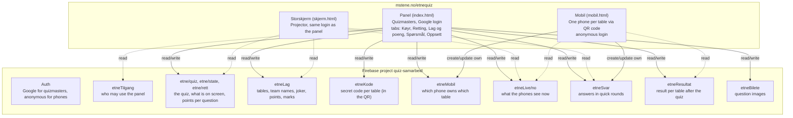
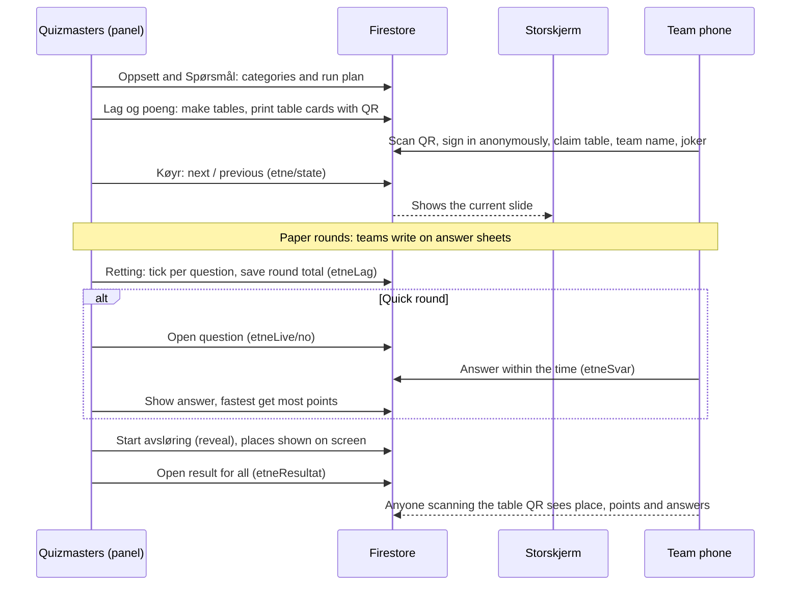

Etnequizen: overview of the whole app (draft)
============================================

The source is in `_etnequiz` (Svelte 5, Vite, Firebase). `npm run build` writes the finished site to `etnequiz/`, which GitHub Pages serves as mstene.no/etnequiz.

**Decided and built on the branch (November 2026):**

- Quick rounds are cut: no answering on phones, speed points, automatic marking or winner slide.
- The QR code on each table opens the team's own page. During the quiz it shows the table, team name and a button to the bar menu. After the quiz, when the result is opened, the same page shows place, points per round and every question with the correct answer and whether the team had it right, partly right or wrong (from Retting).
- Phones no longer claim a table, choose a team name or choose a joker. Quizmasters type the names in Lag og poeng and tick the joker in Retting (it is written on the answer sheet).
- Oppsett has a link to the bar menu. It shows as a button on the team page and as a second, smaller QR code on the table cards.
- Points show with two decimals everywhere.

The tables below describe the app before these changes.

This document lists everything the app does today, so we can agree on what we need, what is broken and what can go. The **Works?** column is for us to fill in after a test run. Where I suspect a problem from reading the code, it says so in **Notes**. Only the QR join is confirmed broken so far.

1. The pieces
-------------

2. How a quiz evening flows
---------------------------

3. Glossary
-----------

| Name | Meaning |
|---|---|
| Køyreplan (run plan) | The ordered list of points shown on the big screen. |
| Punkt | One item in the run plan: `tittel`, `kategori`, `sporsmal`, `fasit`, `pause`, `poengtavle` or `hurtigresultat`. |
| Kategori | A round, for example R1 or Rebus. Has a name, max points and optional answer list. |
| Hurtigrunde (quick round) | A category answered on the phones, scored by speed, with its own standings and prize. Not counted in the main score. |
| Joker | One category per team that counts double. Chosen on the phone or in the panel; locks when the first normal question is shown. |
| Bord / Lag | A table and its team. One `etneLag` document per table. |
| Kode | Secret code per table, printed in the QR. The first phone with the right code owns the table. |
| Frigjer | Release a table so a new phone can claim it. |
| Retting | Marking a round per question: `full`, `annet`, `halv` or own amount. |
| Avsløring | Revealing the final standings on screen, five places at a time until ten are left, then one by one. |
| Resultat | The per-table summary the phones show after the quiz. |

4. Everything the app does
--------------------------

**Login and access**

| Feature | Where | Works? | Keep? (my suggestion) | Notes |
|---|---|---|---|---|
| Google login, access list `etneTilgang` | Panel, Storskjerm | | Keep | A second person needs a document with their email in `etneTilgang`. |
| Anonymous login | Mobil | | Keep | Required for the QR join. Enabled in Firebase. |

**Køyr (run the quiz)**

| Feature | Where | Works? | Keep? | Notes |
|---|---|---|---|---|
| Run plan list, click to jump | Panel | | Keep | |
| Next / previous, arrow keys and presenter clicker | Panel | | Keep | Any open panel on the Køyr tab can move the screen. With two of us, only one should drive. |
| Pause (key B), Poengtavle | Panel, Storskjerm | | Keep | |
| Avsløring (reveal) | Panel, Storskjerm | | Keep | |
| Open big screen in a pop-up window | Panel | | Keep | |
| Live preview of the big screen | Panel | | Keep | |
| Answer and script for the current question, "Berre for deg" | Panel | | Keep | |
| Joker lock (automatic and manual) | Panel, Mobil | | Discuss | Locks on the first normal question shown. If we start with a quick round, check that this happens when we want. |
| Open / hide result for all phones | Panel, Mobil | | Keep | The result is a snapshot. If points change afterwards, press it again. |
| Quick round control: open, countdown, close, show answer and fastest | Panel, Storskjerm, Mobil | | Discuss | Depends on the QR join, so it can't work until that is fixed. |
| Automatic marking of quick answers with typo tolerance, SJEKK, ✓/✗ override | Panel | | Discuss | Same dependency. |

**Retting (new, branch `claude/etnequiz-retting`)**

| Feature | Where | Works? | Keep? | Notes |
|---|---|---|---|---|
| Pick round and team by typing, tick per question, save | Panel | | Keep | Not tested against Firebase yet. |
| Points per question per round, shared | Panel | | Keep | Stored in `etne/rett`. |
| Notice when the other person saves | Panel | | Keep | |
| Statistics per question, hardest questions | Panel | | Keep | Only counts teams marked in this tab. |
| Result list and CSV export | Panel | | Keep | |

**Lag og poeng (teams and points)**

| Feature | Where | Works? | Keep? | Notes |
|---|---|---|---|---|
| Make tables 1 to N, add one table | Panel | | Keep | |
| Team name, joker and points per category, typed in a table | Panel | | Keep for names, joker and corrections | Overlaps with Retting. Typing a total here does not change the marks in Retting, so the two can disagree. |
| Over-max warning, sum, place | Panel | | Keep | |
| Shows which tables have a phone, release a table | Panel | | Keep if the QR stays | |
| Delete a table | Panel | | Keep | Does not delete the table's code or phone. |
| Table cards with QR, Wi-Fi, two per A4, new codes | Panel | | Keep, fix | **Confirmed broken (the QR join).** Making new codes breaks cards already printed. |

**Spørsmål (questions and run plan)**

| Feature | Where | Works? | Keep? | Notes |
|---|---|---|---|---|
| Add, move, duplicate, delete points | Panel | | Keep | |
| Question text, answer, script note | Panel | | Keep | |
| "Nummerert" and "Berre på arket" (only on the paper sheet) | Panel | | Discuss | |
| Image per question (shrunk, stored in Firestore) | Panel, Storskjerm | | Discuss | Images up to about 1 MB each in the database. |
| Quick question settings: A to D or free text, time, accepted answers | Panel | | Discuss | Only needed if we keep quick rounds. |
| "Manglar fasit" badge | Panel | | Keep | |

**Oppsett (setup)**

| Feature | Where | Works? | Keep? | Notes |
|---|---|---|---|---|
| Title, line above, prize text, pause text, Wi-Fi | Panel | | Keep | |
| Categories: name, max, "utan nummer", quick round, prize, answer list, order | Panel | | Keep | The answer list overlaps with the answers on each question. |
| Import whole quiz from JSON file (made from PowerPoint) | Panel | | Discuss | Do we still make quizzes this way? |
| Download a copy (JSON backup) | Panel | | Keep | |
| Reset: screen to start, points and joker, quick rounds, release all phones, delete all teams | Panel | | Keep | "Slett alle lag" leaves codes and phones behind. |

**Storskjerm (big screen)**

| Feature | Where | Works? | Keep? | Notes |
|---|---|---|---|---|
| Follows the panel live, F for full screen | Storskjerm | | Keep | Needs a login with access on the screen computer. |
| Slides: title, category, question with image, answers, pause, scoreboard, reveal | Storskjerm | | Keep | |
| Quick question with ring timer, fastest five, quick round winner | Storskjerm | | Discuss | Follows the quick-round decision. |
| Christmas decoration (snow, lights) | Storskjerm | | Discuss | Fixed Christmas theme. Fine for Jul, odd for Påske. |

**Mobil (team phone)**

| Feature | Where | Works? | Keep? | Notes |
|---|---|---|---|---|
| Scan QR, claim table, team name, joker | Mobil | **No** | Keep, fix | Confirmed broken. See point 6. |
| Rest screen, wakes up for quick rounds | Mobil | | Discuss | |
| Answer quick questions, see own result | Mobil | | Discuss | |
| **Result after the quiz: place, points per category, quick answers, full answer list** | Mobil | | **Keep, main reason for the QR** | Anyone at the table can scan and see it once the result is opened. Depends on the QR fix. |

5. Data
-------

| Collection | Holds | Written by | Read by |
|---|---|---|---|
| `etneTilgang` | One document per quizmaster email | Firebase console only | Panel, Storskjerm |
| `etne/quiz` | The whole quiz: categories and run plan | Panel | Panel, Storskjerm |
| `etne/state` | Current step, mode, reveal, quick-round openings | Panel | Panel, Storskjerm |
| `etne/rett` | Points per question per round | Panel (Retting) | Panel |
| `etneLag` | Table, team name, joker, `poeng`, `rett` marks | Panel | Panel, Storskjerm |
| `etneKode` | Secret code per table | Panel | Panel, rules |
| `etneMobil` | Which phone owns a table, its name and joker | Mobil, Panel | Panel, own phone |
| `etneLive/no` | What the phones show now | Panel | Mobil, Storskjerm |
| `etneSvar` | Quick-round answers | Mobil | Panel, own phone |
| `etneResultat` | Result per table, id `bord_kode` | Panel | Mobil after the result is opened |
| `etneBilete` | Question images | Panel | Panel, Storskjerm |

The Firestore rules are in `quizpremiar/firestore.rules` and have to be pasted into the Firebase console by hand.

6. Known and suspected problems
-------------------------------

1. **QR join does not work (confirmed).** The links are fine: `mstene.no/etnequiz/mobil.html` loads. So the failure is in Firebase. The likely causes, in order:
   - The rules in the console are older than `quizpremiar/firestore.rules`. Phones need the `etneKode`, `etneMobil`, `etneLive` and `etneResultat` rules.
   - The cards were printed before "Lag nye kodar" was pressed, so the codes no longer match.
   - The site's API key or authorized domains in Google Cloud block anonymous login from mstene.no.

   What the phone shows tells us which it is. "Koden passar ikkje" points to codes. "Noko gjekk gale" or "Klarte ikkje kople til" points to login or rules. "Bordet har alt ein mobil" means another phone already owns the table.
2. **Two people editing questions at once overwrite each other.** The whole quiz is one document, saved 0.8 s after the last change. The last save wins, and unsaved edits block the other person's changes from showing. Marking in Retting is not affected.
3. **Both panels drive the screen.** Arrow keys in either panel's Køyr tab move the big screen. Both panels also copy names and jokers from the phones, which is harmless but doubles the writes.
4. **Quarter points show rounded.** Numbers are shown with one decimal, so 0.75 shows as 0,8 on the scoreboard, the phones and in Lag og poeng. Totals are stored correctly.
5. **Retting and Lag og poeng can disagree.** A total typed by hand in Lag og poeng does not change the marks behind it.
6. **Deleting a table or all teams leaves its code and phone behind.**
7. **Reset did not clear Retting marks.** Fixed on the branch.
8. **The quick-round close timer runs only in the panel that opened the question.** The phones and the rules still stop late answers, so this is low risk.

7. Candidates to cut or simplify
--------------------------------

These are my suggestions, to decide together:

- **Quick rounds** (phone answers, speed points, own standings, winner slide). This is the most complex part of the app and depends on the phones working. If we don't use them, the phones only need to join and show the result.
- **Joker on the phone.** It could be written on the answer sheet and typed in Lag og poeng instead.
- **Import from JSON.** Only needed if quizzes are still made from PowerPoint.
- **Answer list per category.** It overlaps with the answers on each question.
- **Typing points in Lag og poeng.** Keep it for corrections, and use Retting as the normal way.

8. Order of work
----------------

| # | Change | Size | Depends on |
|---|---|---|---|
| 0 | Merge Retting and this overview | done, on branch | |
| 1 | Find and fix the QR join | small once we know the cause | Test with a phone, see point 6.1 |
| 2 | Test evening: two panels, one big screen, two or three phones, full run | an hour | 1 |
| 3 | Cut or simplify what we agree on in point 7 | depends on the choice | 2 |
| 4 | Show two decimals everywhere | small | |
| 5 | Make Retting the main way to enter points, Lag og poeng for corrections | small | 2 |
| 6 | Make question editing safe for two people, or agree that one person edits | medium if built | |
| 7 | Clean up codes and phones when tables are deleted | small | |

9. Discussion points
--------------------

1. Do we keep quick rounds, or only use the phones for joining and the result?
2. Who drives the big screen when two of us are in the panel?
3. Should the result open automatically after the reveal, or stay a button?
4. Should the theme follow the event (Jul, Påske), or stay Christmas?
5. What else on the page have we seen not working? Add it to point 6.
