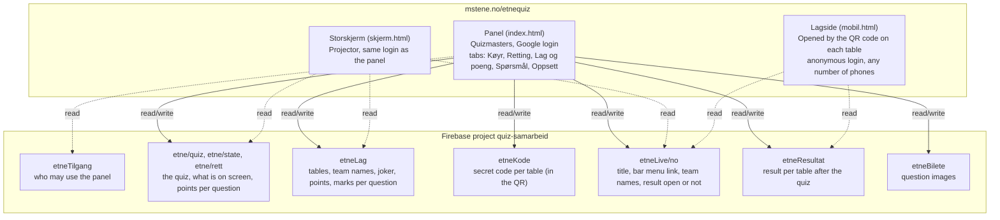
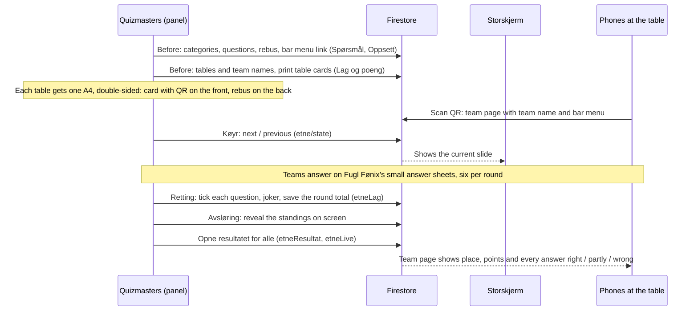

Etnequizen: overview of the app (draft)
=======================================

The source is in `_etnequiz` (Svelte 5, Vite, Firebase). `npm run build` writes the finished site to `etnequiz/`, which GitHub Pages serves on mstene.no.

This describes the new version on the branch `claude/etnequiz-retting`. It is not live on mstene.no/etnequiz until the branch is merged into `main`.

| Address | What it is | Data |
|---|---|---|
| mstene.no/etnequiz | The current live quiz (old version) | Real Firebase |
| mstene.no/etnequiz-ny | The new version, for testing | Real Firebase, the same data as above |
| mstene.no/etnequiz-test | Preview of Retting only, no login, 10 sample teams | Nothing is saved |

1. The pieces
-------------

2. How a quiz evening flows
---------------------------

One person drives the screen in Køyr, the other marks in Retting.

3. Glossary
-----------

| Name | Meaning |
|---|---|
| Køyreplan (run plan) | The ordered list of points shown on the big screen. |
| Punkt | One item in the run plan: `tittel`, `kategori`, `sporsmal`, `fasit`, `pause` or `poengtavle`. |
| Kategori | A round, for example Julerebus or Musikk. Has a name, max points, optional answer list and "utan nummer". |
| Berre på arket | A question that is not shown on screen but counts in the answers and in Retting. Used for the rebus. |
| Joker | One category per team that counts double. Written on the answer sheet, ticked in Retting. |
| Bord / Lag | A table and its team. One `etneLag` document per table. |
| Kode | Secret code per table in its QR code, so a table only sees its own result. |
| Lagside (team page) | What the QR code opens: team name and bar menu during the quiz, the result after. |
| Retting | Marking a round per question: `full`, `annet`, `halv` or own amount. |
| Avsløring | Revealing the final standings on screen, five places at a time until ten are left, then one by one. |

4. Everything the app does
--------------------------

**Tested** says how far each part has been checked: *fake data* means in a browser against a fake database, *real* means on mstene.no with the real Firebase.

**Køyr (run the quiz)**

| Feature | Tested | Notes |
|---|---|---|
| Run plan, click to jump, next / previous with keys or presenter clicker | Unchanged from before | Any panel on the Køyr tab moves the screen. Only one of us should drive. |
| Pause (key B), Poengtavle, Avsløring | Unchanged | |
| Open big screen in a pop-up, live preview | Unchanged | |
| Answer and script for the current question, "Berre for deg" | Unchanged | |
| Opne / skjul resultatet for alle | Fake data | Sends the result to every table with a name and a QR code. Press again if points change. |

**Retting (marking)**

| Feature | Tested | Notes |
|---|---|---|
| Pick round, type part of a team name, Enter picks the best match | Fake data, preview | Teams already marked go to the bottom with ✓ and who marked them. |
| Full / Annet / Halv / own amount per question, keys 1 2 3 0, Enter saves | Fake data, preview | The answer is shown under each question. |
| Joker button | Fake data | Sets or moves the team's joker to this round. |
| Points per question per round ("Sett poeng") | Fake data | Shared between both quizmasters. Half is always half of full. |
| Notice when the other person saves | Not tested | Needs two logins at once. |
| Statistics per question, hardest questions | Fake data | Only counts teams marked in Retting. |
| Result list with CSV export | Fake data | |

**Lag og poeng (teams and points)**

| Feature | Tested | Notes |
|---|---|---|
| Make tables 1 to N, add one, delete one | Unchanged | |
| Team name and joker | Unchanged | Points per category are shown here but can only be set in Retting. |
| Table cards with QR code | **Real** (the QR shows after the rules fix) | If saving the codes fails, it says so and offers "Prøv igjen" instead of flickering. |
| Wi-Fi on the card | Fake data | Shown when set in Oppsett. The bar menu has no QR of its own; it is a button on the team page. |
| Rebus on the back ("Rebus på arket") | Fake data, printed to PDF | One A4 per table, print double-sided. Long text questions as rows, picture questions as boxes with text and picture together. "Ingen" gives two cards per A4. |

**Spørsmål (questions and run plan)**

| Feature | Tested | Notes |
|---|---|---|
| Add, move, duplicate, delete points | Unchanged | |
| Question text, answer, script note, image | Unchanged | |
| "Nummerert" and "Berre på arket" | Unchanged | |
| "Manglar fasit" badge | Unchanged | |

**Oppsett (setup)**

| Feature | Tested | Notes |
|---|---|---|
| Title, line above, prize text, pause text, Wi-Fi | Unchanged | |
| Link to the bar menu | Fake data | Button on the team page. |
| Categories: name, max, "utan nummer", answer list, order | Unchanged | |
| Legg til frå fil | Fake data | Adds questions and teams from a file without removing anything. Skips questions that already exist, so it can't fix an answer. |
| Erstatt heile quizen frå fil | Unchanged | Replaces the run plan and categories. |
| Download a copy (JSON backup) | Unchanged | |
| Reset: screen to start, points and joker (also clears Retting marks and hides the result), delete all teams (also deletes their codes) | Fake data | |

**Storskjerm (big screen)**

| Feature | Tested | Notes |
|---|---|---|
| Follows the panel live, F for full screen | Unchanged | Needs a login with access on the screen computer. |
| Slides: title, category, question with image, answers, pause, scoreboard, reveal | Unchanged | Christmas decoration (snow, lights) is always on. |

**Lagside (team page on the phone)**

| Feature | Tested | Notes |
|---|---|---|
| Scan the table's QR code, any number of phones | Real, as far as opening the page | |
| During the quiz: table, team name, bar menu button | Fake data | Team name comes from Lag og poeng. |
| After "Opne resultatet": place, total, joker, points per round | Fake data | |
| Every question with the correct answer and ✓ / ≈ / ½ / ✗ | Fake data | Only for rounds marked in Retting. Rounds typed by hand show the answers without marks. |
| Can be added to the phone's home screen | Not tested | |

**Removed in this version**

Quick rounds (answering on phones, speed points, automatic marking, the winner slide), one phone per table, releasing a table, choosing the team name and joker on the phone.

5. Data
-------

| Collection | Holds | Written by | Read by |
|---|---|---|---|
| `etneTilgang` | One document per quizmaster email, lowercase | Firebase console only | Panel, Storskjerm |
| `etne/quiz` | The whole quiz: categories, run plan, bar menu link | Panel | Panel, Storskjerm |
| `etne/state` | Current step, mode, reveal | Panel | Panel, Storskjerm |
| `etne/rett` | Points per question per round | Panel (Retting) | Panel |
| `etneLag` | Table, team name, joker, `poeng`, `rett` marks per question | Panel | Panel, Storskjerm |
| `etneKode` | Secret code per table | Panel | Panel |
| `etneLive/no` | Title, bar menu link, team names, whether the result is open | Panel | Team page, Panel |
| `etneResultat` | Result per table, id `bord_kode` | Panel | Team page, only after the result is opened |
| `etneBilete` | Question images | Panel | Panel, Storskjerm |

The Firestore rules are in `quizpremiar/firestore.rules` and have to be pasted into the Firebase console by hand (Firestore → Rules → Publish). The console now has the rules for `etneKode`, `etneLive` and `etneResultat`. The old rules for `etneMobil` and `etneSvar` are gone, so the phone join on the old live version no longer works.

6. Known problems and open points
---------------------------------

1. **Not tested end to end on a real phone:** the team name and bar menu on the team page, and the result after "Opne resultatet". Do a test run on mstene.no/etnequiz-ny before a real quiz.
2. **Two people editing questions at once overwrite each other.** The whole quiz is one document. Edit questions before the evening, one person at a time. Marking in Retting is safe.
3. **Both panels drive the big screen** from the Køyr tab.
4. **Points are only set in Retting.** Lag og poeng shows them read-only, so the two can no longer disagree.
5. **Table cards printed from /etnequiz-ny point to /etnequiz-ny.** Print the real cards after the merge.
6. **Christmas decoration is always on**, also for Påske.
7. **I can't edit the database from my session.** Changes go through files and "Legg til frå fil", or you do them in the panel.

7. Order of work
----------------

| # | Change | Status |
|---|---|---|
| 1 | Retting, team page, rebus on the card, cut quick rounds | Done, on branch, test at /etnequiz-ny |
| 2 | Firestore rules for codes, team page and results | Done, published in the console |
| 3 | Test run: two panels, big screen, two or three phones, mark a round, open the result | Next |
| 4 | Merge into `main` so it replaces /etnequiz, then remove /etnequiz-ny and /etnequiz-test | After 3 |
| 5 | Print the real table cards with rebus | After 4 |
| 6 | Theme for the big screen: Jul, Påske, Nøytral | Not started, to decide |
| 7 | Merge Spørsmål and Oppsett into one "Quiz" tab, result list in the header | Not started, to decide |

8. Discussion points
--------------------

1. Do rebus answers go on the rebus sheet (keep the answer lines) or on one of Fugl Fønix's answer sheets (remove the lines, bigger pictures)?
2. Who drives the big screen when two of us are in the panel?
3. Should the result open automatically after the reveal, or stay a button?
4. Do we want the theme setting (point 7.6) and the tab merge (point 7.7)?
