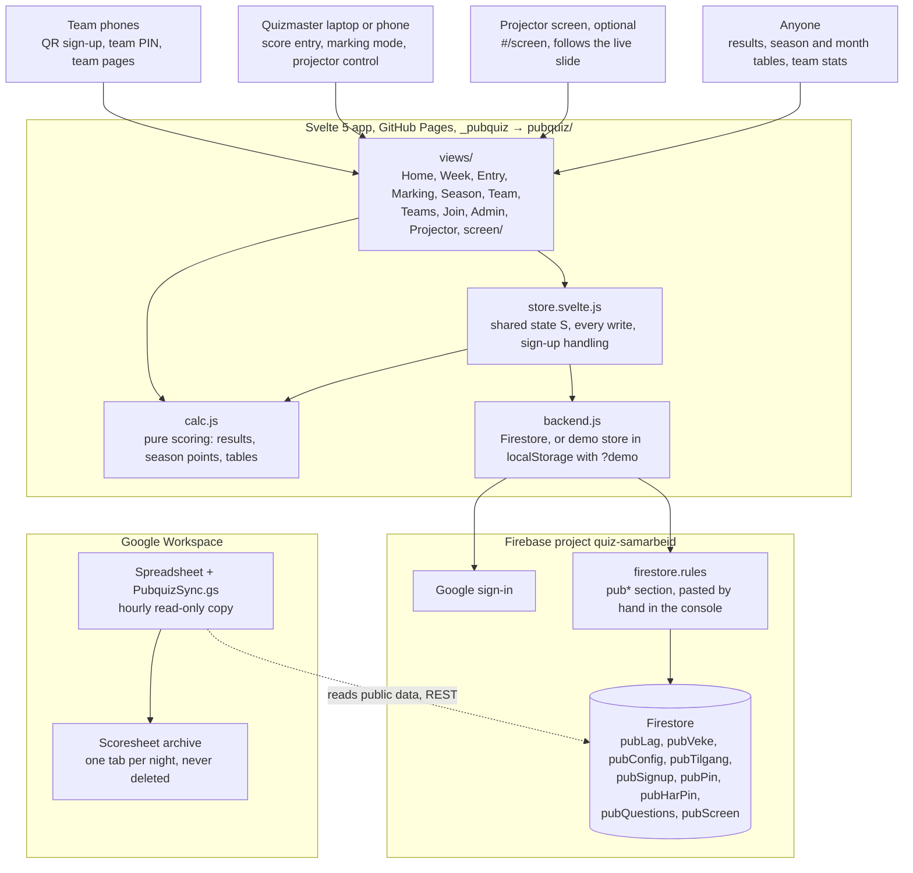
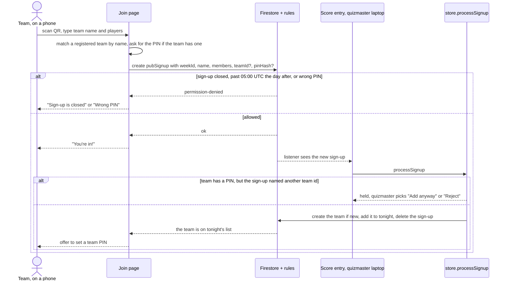
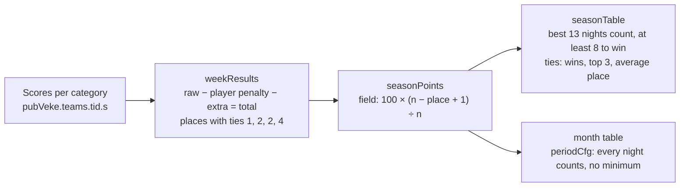

# Quiz på Kvarteret: architecture overview

The weekly quiz's score app at **mstene.no/pubquiz**. Separate from Etnequizen: own collections, own app, same Firebase project.

## 1. The pieces

## 2. How a QR sign-up flows

## 3. How a score becomes season points

Totals are always computed from the raw scores, so changing the rules in Admin changes every table, past nights included.

## 4. Glossary

| Name | Meaning |
|---|---|
| Night (week) | One quiz night: a date, categories and the teams that played. Document in `pubVeke`. |
| Team | A team in the register, with other spellings (`aliases`). Document in `pubLag`. Results build up across nights under one team. |
| Category | One scored part of a night, for example Category 1, Category 2, Round 2, Picture quiz. |
| Round | Categories grouped under one name. Round 1 has two categories. |
| Raw score | Sum of all categories. |
| Penalty | Points off for players over the limit (default: 5 per player over 6), plus any extra deduction. |
| Season | Spring (January–June) or Autumn (July–December). |
| Season points | Points for one night: the share of the field you beat. The winner always gets 100. |
| Qualified | Played enough nights to win the season (default 8). |
| Sign-up | A team's QR sign-up, waiting in `pubSignup` until the quizmaster's screen picks it up. |
| Sign-up open | The quizmaster opened sign-up for that night. It closes by itself at 05:00 UTC the morning after. |
| Team PIN | Optional 4–8 digit code. Once set, signing up under that team name needs it. Only settable on a quiz night by a team on that night's list. |
| Held sign-up | A sign-up for a PIN team that skipped the PIN check. The quizmaster decides. |
| Marking mode | Score entry one team at a time: search, type scores, the team drops off the list. |
| Score keeper | Role that can enter scores, run nights and add other score keepers. |
| Admin | Can also change rules, give admin access, delete, merge and remove PINs. Every quiz@ and [role].quiz@samfunnetibergen.no account is an admin. |
| Projector | Optional big screen, switched on per night: welcome + QR, questions, answers, results reveal, season table. |
| Slide key | What the projector shows: `welcome`, `title:c1`, `q:c1:0`, `answers:c1`, `a:c1:0`, `break`, `reveal`, `season`, `blank`. |
| Archive | The separate spreadsheet with one tab per night, locked 2 days after the quiz. |

## 5. The functions

**Pure scoring, `calc.js`** (no database, safe to test on their own)

| Function | Input | Output |
|---|---|---|
| `weekResults` | night, teams, config | Rows with raw, penalty, total, place, season points |
| `seasonPoints` | row, team count, config | Points for one night (field, placement or raw mode) |
| `seasonTable` | nights, teams, config, date test | Ranked rows: score, played, wins, podiums, average place, qualified |
| `periods`, `periodCfg` | nights | Semesters, years, all time and months; months count every night |
| `categoryStats` | nights, teams, config, date test | Each team's strengths per category |
| `matchTeams`, `norm` | text, teams | Similar team names, "Hansa-Lovers" = "hansa lovers" |
| `signupLive`, `signupCloses` | night | Whether QR sign-up is open right now |

**Writes and app logic, `store.svelte.js`**

| Function | Who | What it does |
|---|---|---|
| `createWeek` | score keeper | New night, optionally with last week's teams |
| `setScore`, `setField`, `addTeamToWeek`, `removeTeamFromWeek` | score keeper | Score entry |
| `createTeam`, `findTeamByName` | score keeper | Register lookups |
| `setSignupOpen` | score keeper | Open one night, close every other |
| `processSignup` | score keeper's screen | Turn a sign-up into a team on tonight's list, or hold it |
| `mergeTeams`, `deleteTeam`, `removePin` | admin | Clean up the register |
| `importOld`, `removeImported` | admin | The autumn 2026 spreadsheet nights, for demoing |
| `pinHash`, `validPin` | anyone | SHA-256 of `pubquiz:<teamId>:<pin>` |

**Projector, `screen.js`**: `slidePlan` (slide order for a night), `parseKey`, `step` (next and back, one team at a time in the reveal).

**Backend, `backend.js`**: the same interface for Firestore and the demo store: `listen*`, `set*`/`update*`/`delete*` per collection, `addSignup`, `setPin`, `setQuestions`, `setScreen`, `batch`.

## 6. Data and who may do what

Enforced by `quizpremiar/firestore.rules`, not just by the app.

| Collection | Holds | Read | Write |
|---|---|---|---|
| `pubLag` | Teams | anyone | create, update: score keeper · delete: admin |
| `pubVeke` | Nights, scores, sign-up flag, projector on or off for that night | anyone | create, update: score keeper · delete: admin |
| `pubConfig` | Scoring rules | anyone | admin |
| `pubTilgang` | Access list, `role: "scorer"` or admin | own entry, score keepers | admins add anyone; score keepers add and remove score keepers only |
| `pubSignup` | QR sign-ups waiting | score keepers | create: anyone while sign-up is live, with the right PIN · delete: score keepers |
| `pubPin` | PIN hash per team | admins | create: anyone, only while sign-up is live, for a team on that night's list · delete: admin |
| `pubHarPin` | Public "has a PIN" marker | anyone | created together with the PIN · delete: admin |
| `pubQuestions` | Projector questions and answers per night | score keepers | score keepers |
| `pubScreen/live` | Which slide the projector shows | anyone | score keepers |

## 7. What gets refused

Firestore answers `permission-denied`; the app turns it into text.

| Case | Refused by | Shown as |
|---|---|---|
| QR sign-up when the quizmaster hasn't opened it, or after 05:00 UTC the next morning | `pubSignupLive` | "Sign-up is closed. Ask the quizmaster." |
| Sign-up under a PIN team with a wrong or missing PIN | `pubPinOk` | "Wrong PIN" |
| PIN on a team that already has one, outside sign-up, or not on tonight's list | `pubPin` create | "Couldn't set the PIN…" |
| Score keeper deleting, merging, changing rules, giving admin | `pubAdmin` | Buttons hidden; "Not allowed to save" if forced |
| Not signed in, or signed in without access | `pubScorer` | "No edit access" |
| Reading projector questions without access | `pubQuestions` | "Sign in as a score keeper on this screen…" |
| Sheet refresh when the website returns no nights | `PubquizSync.gs` | Error in Apps Script; the sheet is left as it was |

## 8. Status

| # | Piece | State |
|---|---|---|
| 1 | Score entry, register, results, season table, team pages, category strengths | Live |
| 2 | QR sign-up with name matching | Live |
| 3 | Team PIN, only settable on a quiz night | Live, needs the latest rules |
| 4 | Fair season rules: share of the field, best 13, at least 8, tiebreaks | Live |
| 5 | Month table, every night counts | Live |
| 6 | Google Sheet sync, Nights view with dropdowns, scoresheet archive | Script ready, paste into Apps Script |
| 7 | Marking mode | Live |
| 8 | Sign-up closes by itself the morning after | Live, needs the latest rules |
| 9 | Score keeper role | Live, needs the latest rules |
| 10 | Projector: questions, answers, results reveal, season table | Live, switched on per night with "+ Projector", needs the latest rules |
| 11 | Quiz på Kvarteret look: mint in Samfunnet's design style | Live, see `quiz-kit.md` |

Ideas for later: picture-round images uploaded instead of linked, a timer slide, team history charts, Norwegian text.

## 9. Discussion points

1. **Publish the rules.** Points 3, 8, 9 and 10 only hold fully once the latest `firestore.rules` is published in the Firebase console.

2. **Clean up the demo import.** "Remove imported data" in Admin deletes the four spreadsheet nights and the teams that only came from them. Before that, merge the Conquistadorene spellings under Teams.

3. **Category names.** Nights start with "Category 1" and "Category 2"; renaming them to the real Round 1 themes makes the strengths page useful.

4. **Closing time is UTC.** Sign-up closes at 05:00 UTC: 06:00 in winter, 07:00 in summer. Fine for evening quizzes.

5. **Who owns the Sheet script.** The hourly trigger runs as whoever ran `setup`. If that person leaves, someone with access should run `setup` again.

6. **Picture links.** Projector pictures are links (for example from Drive set to "anyone with the link"). Uploading would need Firebase Storage and more rules.
